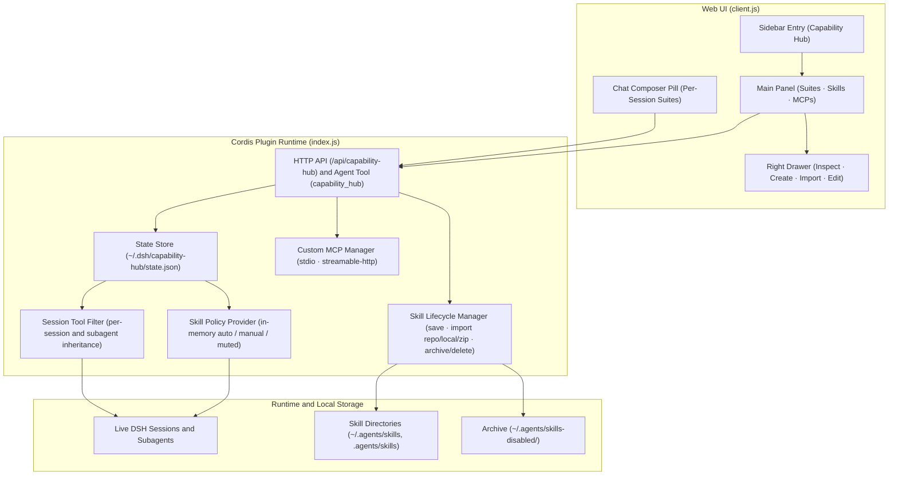

# @fengguanghuai/dsh-capability-hub

[](https://www.npmjs.com/package/@fengguanghuai/dsh-capability-hub)
[](./LICENSE)
[](https://github.com/topics/dsh-plugin)

**English** | [简体中文](./README.zh-CN.md)

A unified capability hub for **DeepSeek Harness (DSH)** that lets you organize **Skills** and **MCP servers** into switchable suites, control per-session capability injection from the chat composer, and manage local skills end-to-end without cluttering your context window.

---

## Preview

| Suites & Budget Overview | Per-Suite MCP & Skill Controls | Skills & Per-Session Composer |
| --- | --- | --- |
|  |  |  |

## Key Features

- **Switchable Capability Suites**: Group related MCP servers and Skills into scenario suites (e.g., Office docs, architecture/artifacts, media workflows) and toggle them with one click.
- **Per-Session Injection (Composer Popover)**: Pick which suites are active for the **current session** directly from the chat composer without affecting global defaults or other sessions. Subagents inherit their parent session's active suites automatically.
- **Non-Destructive Skill Policy**: Override Skill invocation between `auto`, `manual` (`/skill`-only), and `muted` in memory—never dirtying `SKILL.md` files on disk.
- **Full Skill Lifecycle**:
  - **Create / Paste**: Write or paste a `SKILL.md` (with automatic frontmatter parsing) into user (`~/.agents/skills`, `~/.dsh/skills`) or project (`.agents/skills`, `.dsh/skills`) directories.
  - **Import**: Install from a repository (`npx -y skills add`), import from a local directory, or upload a `.zip` archive (with path-traversal protection).
  - **Edit & Safe Uninstall**: Edit writable `SKILL.md` files in place, or remove them by archiving to `~/.agents/skills-disabled/` or permanently deleting them (while cleaning up suite references). Built-in/bundled skills remain read-only.
- **Granular MCP Control**: Toggle individual `mcp__<server>__<tool>` tools, reconnect servers, or add custom `stdio` / `streamable-http` MCP servers.
- **Agent Tool (`capability_hub`)**: Exposes status inspection, suite/skill/MCP toggling, and skill management directly to the agent.

## Installation

### Via CLI (Recommended)

```bash
# Install from npm into the web profile
dsh plugin --profile web add @fengguanghuai/dsh-capability-hub

# Or without a global dsh install
npx @deepseek-ai/dsh plugin --profile web add @fengguanghuai/dsh-capability-hub

# Or install directly from GitHub
dsh plugin --profile web add github:fengguanghuai/dsh-capability-hub
```

> Restart `dsh web` (or reopen the desktop app) after installing if the sidebar entry does not appear immediately.

### Via DeepSeek Harness UI

Open **Plugins → Add plugin** and enter either:

- `@fengguanghuai/dsh-capability-hub`
- `github:fengguanghuai/dsh-capability-hub`

### Update & Uninstall

```bash
# Update to the latest version
dsh plugin --profile web update @fengguanghuai/dsh-capability-hub

# Remove the plugin
dsh plugin --profile web remove @fengguanghuai/dsh-capability-hub
```

> Disabling or removing this bundle immediately restores default tool and skill visibility.

## Quick Start

1. Open **Capability Hub** from the top-left sidebar.
2. Switch between the **Suites**, **Skills**, and **MCPs** tabs—the top-right action button adapts automatically (`+ New Suite` / `+ Add Skill` / `+ Connect MCP`).
3. Create a suite by selecting related MCP servers and Skills.
4. In any chat session, click the **Suites** pill in the chat composer to override active suites for that session only (subagents inherit the selection automatically).

## Architecture



## Data, Permissions & Safety

- **Local State**: Persists suite definitions, skill policy overrides, and custom MCP metadata in `~/.dsh/capability-hub/state.json`.
- **Skill Files**: Reads/writes user-managed skills under `~/.agents/skills`, `~/.dsh/skills`, `.agents/skills`, and `.dsh/skills`. Archiving moves skills to `~/.agents/skills-disabled/`. Built-in skills remain read-only, and skill policy overrides (`auto` / `manual` / `muted`) stay in memory without modifying `SKILL.md`.
- **External Commands**: Importing a skill from a Git repository invokes `npx -y skills add`.
- **Exposed Surfaces**: Registers the local HTTP endpoint `/api/capability-hub` and the `capability_hub` agent tool.
- **Privacy**: Runs entirely locally with no telemetry or external data collection.

## Development & Testing

```bash
node --check index.js
node --check client.js
node test.mjs
```

## License

[MIT](./LICENSE)
