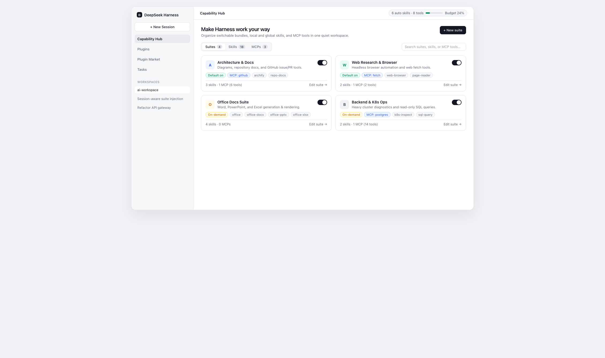
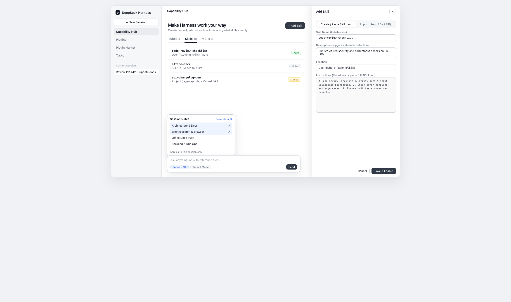

# @fengguanghuai/dsh-capability-hub

[](https://www.npmjs.com/package/@fengguanghuai/dsh-capability-hub)
[](./LICENSE)

A unified capability hub for **DeepSeek Harness (DSH)** that lets you organize **Skills** and **MCP servers** into switchable suites, control per-session capability injection from the chat composer, and manage local skills end-to-end without cluttering your context window.

[中文说明](#中文说明)

---

## Preview

| Suites & Budget Overview | Skills Drawer & Per-Session Composer |
| --- | --- |
|  |  |

## Architecture


## Key Features

- **Switchable Capability Suites**: Group related MCP servers and Skills into scenario suites (e.g., Office docs, architecture/artifacts, media workflows) and toggle them with one click.
- **Per-Session Injection (Composer Popover)**: Pick which suites are active for the **current session** directly from the chat composer without affecting global defaults or other sessions. Subagents inherit their parent session's active suites automatically.
- **Non-Destructive Skill Policy**: Override Skill invocation between `auto`, `manual` (`/skill`-only), and `muted` in memory—never dirtying `SKILL.md` files on disk.
- **Full Skill Lifecycle**:
  - **Create / Paste**: Write or paste a `SKILL.md` (with automatic frontmatter parsing) into user (`~/.agents/skills`, `~/.dsh/skills`) or project (`.agents/skills`, `.dsh/skills`) directories.
  - **Import**: Install from a repository (`npx -y skills add`), import from a local directory, or upload a `.zip` archive (with path-traversal protection).
  - **Edit & Safe Uninstall**: Edit writable `SKILL.md` files in place, or remove them by archiving to `~/.agents/skills-disabled/` or permanently deleting them (while cleaning up suite references). Built-in/bundled skills remain read-only.
- **Granular MCP Control**: Toggle individual `mcp__<server>__<tool>` tools, reconnect servers, or add custom `stdio` / `streamable-http` MCP servers.
- **Agent Tool (`capability_hub`)**: Exposes status inspection, suite/skill/MCP toggling, and skill management directly to the agent.

## Installation

In DeepSeek Harness, open **Plugins → Install** and enter either:

```text
@fengguanghuai/dsh-capability-hub
```

or install directly from GitHub:

```text
github:fengguanghuai/dsh-capability-hub
```

## Development & Testing

```bash
node --check index.js
node --check client.js
node test.mjs
```

---

## 中文说明

**能力中心（Capability Hub）** 是面向 **DeepSeek Harness (DSH)** 的统一能力编排插件，用于解决多场景下 Skill 与 MCP 工具过多、上下文膨胀的问题：

- **场景套件与会话级按需注入**：将关联的 MCP 与 Skill 打包为套件；在聊天框底部的「套件」快捷入口中，可单独指定**当前会话**启用哪些套件（子 Agent 会自动继承父会话策略），互不干扰。
- **无侵入 Skill 策略控制**：在内存中动态切换 `自动触发 (auto)`、`仅手动 /skill (manual)` 与 `静默隐藏 (muted)`，不修改磁盘上的原始 `SKILL.md`。
- **Skill 增删改查**：右上角按钮随当前 Tab 联动（`+ 新建套件` / `+ 添加 Skill` / `+ 连接 MCP`），支持新建或粘贴 `SKILL.md`、从仓库/本地目录/`.zip` 导入、在线编辑，以及「移入归档 (`~/.agents/skills-disabled`)」或「彻底删除」。
- **MCP 精细化管理**：支持工具级开关、服务重连及自定义 `stdio` / `streamable-http` MCP 连接。

## License

MIT
