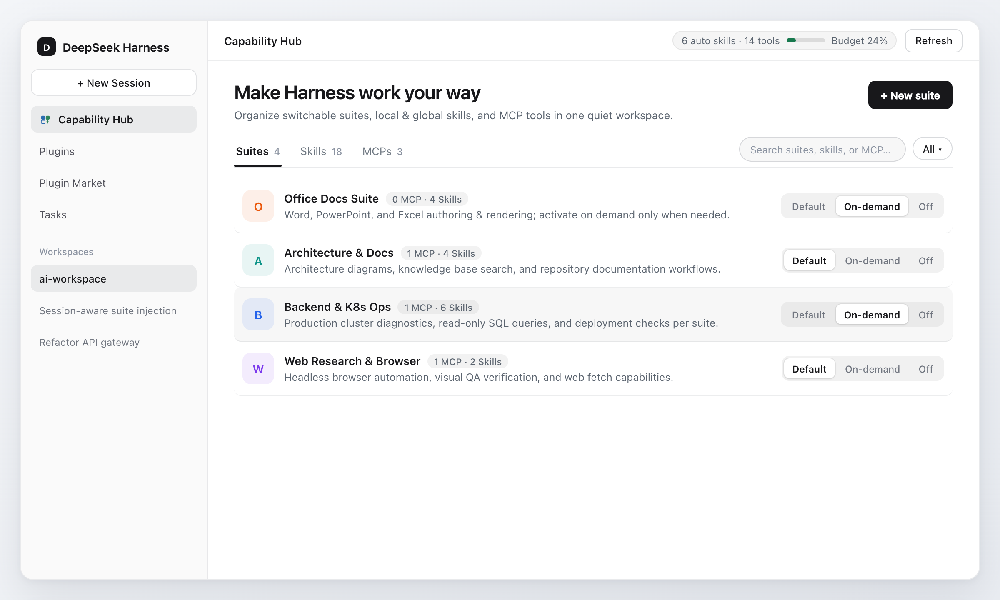
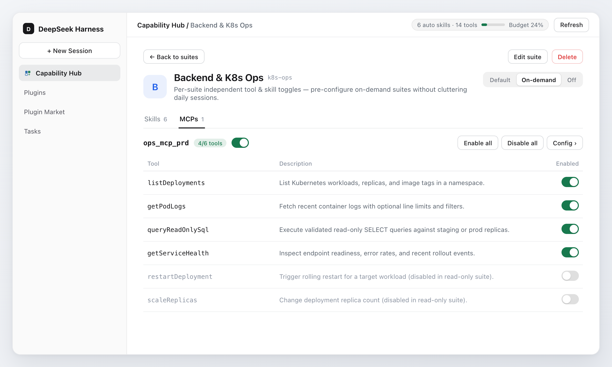
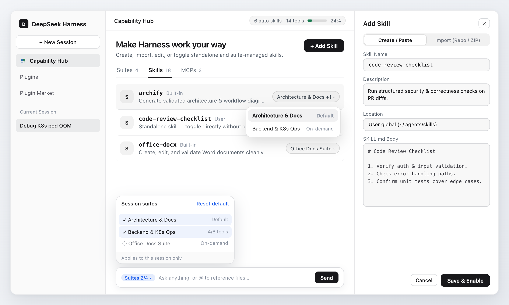

# @fengguanghuai/dsh-capability-hub（能力中心）

[](https://www.npmjs.com/package/@fengguanghuai/dsh-capability-hub)
[](./LICENSE)
[](https://github.com/topics/dsh-plugin)

[English](./README.md) | **简体中文**

**能力中心（Capability Hub）** 是面向 **DeepSeek Harness (DSH)** 的统一能力编排插件。它可以将 **Skills** 与 **MCP 服务** 打包为可一键切换的场景套件，支持在聊天输入框中按会话动态注入能力，并提供本地 Skill 的全生命周期管理，避免工具与上下文膨胀。

---

## 界面预览

| 套件与上下文预算总览 | 套件内独立 MCP 工具与 Skill 控制 | Skills 与会话级套件注入 |
| --- | --- | --- |
|  |  |  |

## 核心特性

- **场景套件一键切换**：将关联的 MCP 服务与 Skill 打包为场景套件（如文档处理、架构绘图、媒体工作流等），一键启用或停用。
- **会话级按需注入（聊天框快捷入口）**：在聊天框底部的「套件」入口中，单独指定**当前会话**启用的套件，不影响全局默认配置或其他会话；子 Agent 会自动继承父会话的套件策略。
- **无侵入 Skill 策略控制**：在内存中动态切换 `自动触发 (auto)`、`仅手动 /skill (manual)` 与 `静默隐藏 (muted)`，绝不修改磁盘上的原始 `SKILL.md`。
- **Skill 全生命周期管理**：
  - **新建 / 粘贴**：支持在线编写或粘贴 `SKILL.md`（自动解析 frontmatter），写入用户目录（`~/.agents/skills`、`~/.dsh/skills`）或项目目录（`.agents/skills`、`.dsh/skills`）。
  - **多源导入**：支持从仓库导入（`npx -y skills add`）、本地目录导入以及 `.zip` 压缩包上传（内置路径穿越防护）。
  - **编辑与安全卸载**：支持在线编辑可写 Skill；移除时可选择「移入归档（`~/.agents/skills-disabled/`）」或「彻底删除」（自动清理套件引用）。内置 Skill 保持只读。
- **MCP 精细化控制**：支持工具级开关（`mcp__<server>__<tool>`）、服务重连及新增自定义 `stdio` / `streamable-http` MCP 连接。
- **Agent 工具（`capability_hub`）**：向智能体开放状态查看、套件/Skill/MCP 启停以及 Skill 管理能力。

## 安装方式

### 通过 CLI 安装（推荐）

```bash
# 从 npm 安装到 web profile
dsh plugin --profile web add @fengguanghuai/dsh-capability-hub

# 如未全局安装 dsh，可使用 npx
npx @deepseek-ai/dsh plugin --profile web add @fengguanghuai/dsh-capability-hub

# 或直接从 GitHub 安装
dsh plugin --profile web add github:fengguanghuai/dsh-capability-hub
```

> 安装完成后，如左侧栏未立即出现入口，请重启 `dsh web`（或重启桌面端应用）。

### 通过 DeepSeek Harness 界面安装

打开 **Plugins → Add plugin**（插件 → 添加插件），输入以下任意地址：

- `@fengguanghuai/dsh-capability-hub`
- `github:fengguanghuai/dsh-capability-hub`

### 更新与卸载

```bash
# 更新到最新版本
dsh plugin --profile web update @fengguanghuai/dsh-capability-hub

# 卸载插件
dsh plugin --profile web remove @fengguanghuai/dsh-capability-hub
```

> 禁用或卸载本插件后，会自动恢复全部默认的工具与 Skill 可见性策略。

## 快速上手

1. 点击左上角侧边栏的 **能力中心（Capability Hub）** 打开主面板。
2. 顶部可在 **套件 / Skills / MCP** 之间切换，右上角操作按钮会随当前 Tab 自动联动（`+ 新建套件` / `+ 添加 Skill` / `+ 连接 MCP`）。
3. 创建一个场景套件并勾选关联的 MCP 服务与 Skill。
4. 在任意对话中，点击聊天输入框底部的「套件」胶囊入口，即可为当前会话单独调整启用的套件。

## 数据存储、权限与安全说明

- **本地状态文件**：套件配置、Skill 策略覆写与自定义 MCP 元数据保存在 `~/.dsh/capability-hub/state.json`。
- **Skill 目录读写**：仅读写 `~/.agents/skills`、`~/.dsh/skills`、`.agents/skills`、`.dsh/skills`，归档目录为 `~/.agents/skills-disabled/`；内置 Skill 只读；策略切换在内存中生效，不改动原 `SKILL.md`。
- **外部命令**：仅在使用「从仓库导入 Skill」功能时执行 `npx -y skills add`。
- **扩展接口**：注册本地 HTTP 接口 `/api/capability-hub` 与 Agent 工具 `capability_hub`。
- **隐私**：完全在本地运行，无遥测、无外部数据上报。

## 开发与测试

```bash
node --check index.js
node --check client.js
node test.mjs
```

## 开源协议

[MIT](./LICENSE)
